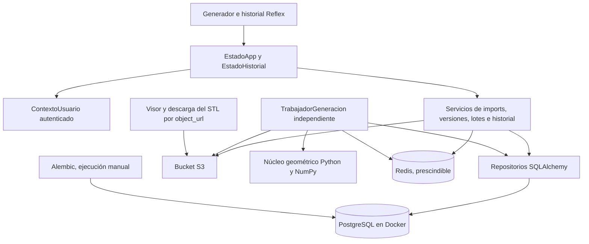
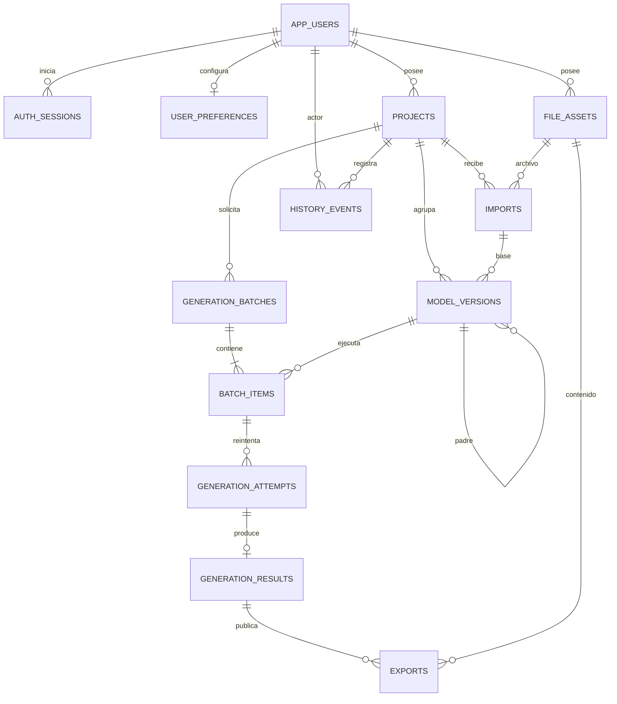

# Base de datos

El esquema vigente es `Base.metadata` de [`web/persistence/Modelos.py`](../../apps/web/web/persistence/Modelos.py): 13 tablas, restricciones, índices y valores por defecto. El comportamiento de cuentas, cola e historial está en [ARQUITECTURA.md](ARQUITECTURA.md). Los comandos de Docker están en el `Makefile` (`make db-help`) y el arranque en [OPERACION_Y_PRUEBAS.md](OPERACION_Y_PRUEBAS.md#base-de-datos).

El primer `make db-up` sobre un volumen nuevo ejecuta [`apps/db/init/01_roles.sh`](../../apps/db/init/01_roles.sh): crea los roles `ortesislab_migrator`, `ortesislab_app`, `ortesislab_worker` y `ortesislab_backup`, y el esquema `ortesislab` vacío. No crea tablas. `make db-reset` recrea `ortesislab_dev` y reaplica esos permisos con [`apps/db/preparar_base.sql`](../../apps/db/preparar_base.sql). No hay fixture ni base de pruebas en el repositorio.

Alembic aplica las tablas con el rol migrador. La revisión inicial está en [`apps/db/alembic/versions/20261112_1200_esquema_inicial.py`](../../apps/db/alembic/versions/20261112_1200_esquema_inicial.py). `env.py` lee la URL de `Ajustes`, usa `-x base=test` para la base de pruebas, guarda `alembic_version` en `ortesislab` y la ignora al comparar.

`user_preferences.auto_scale` y `model_versions.auto_scale` siguen en el esquema. La generación no las lee. Una preferencia nueva y cada versión nueva se insertan con `false`. Quitar las columnas exige una revisión de Alembic que esta entrega no incluye.

## Arquitectura



PostgreSQL conserva relaciones, parámetros, métricas y estados. El bucket conserva los bytes. Reflex solo conserva filtros, identificadores y DTO de presentación. Las sesiones no se guardan dentro de `rx.State`.

El motor SQLAlchemy es síncrono. Los handlers llaman a los servicios con `asyncio.to_thread`. Cada transacción es corta: no sigue abierta mientras se genera geometría ni mientras se transfiere un archivo. El backend abre de 1 a 4 conexiones y el trabajador hasta 2.

## Modelo entidad-relación

El modelo distingue una **versión de diseño** de sus **intentos de ejecución**. Reintentar una versión crea otro intento; editar sus parámetros crea otra versión. Las columnas están en las tablas de abajo; el grafo solo muestra quién apunta a quién.



`PK` es la clave primaria y `FK` una clave foránea. «Única con …» en la columna Clave son las columnas de una sola restricción. `float8` es `double precision`. La celda vacía de Nulo significa `NOT NULL`. Las tablas de un usuario tienen `UNIQUE (user_id, id)` para referenciarlas por dueño, y las relaciones de dominio comprueban ese par con una clave foránea compuesta, declarada en [`Modelos.py`](../../apps/web/web/persistence/Modelos.py). Un lote confirmado tiene al menos un ítem; eso se comprueba al crearlo. `created_at` vale `now()`. `updated_at` solo está en filas mutables. El borrado relacional es `RESTRICT`.

### `app_users`

| Columna | Tipo | Nulo | Clave |
|---|---|---|---|
| id | uuid | | PK |
| auth_issuer | text | | Única con auth_subject |
| auth_subject | text | | Única con auth_issuer |
| email | text | sí | |
| display_name | text | | |
| status | text | | |
| created_at | timestamptz | | |
| updated_at | timestamptz | | |

### `auth_sessions`

| Columna | Tipo | Nulo | Clave |
|---|---|---|---|
| id | uuid | | PK |
| user_id | uuid | | FK app_users |
| token_sha256 | char(64) | | Única |
| created_at | timestamptz | | |
| expires_at | timestamptz | | |
| revoked_at | timestamptz | sí | |

### `user_preferences`

| Columna | Tipo | Nulo | Clave |
|---|---|---|---|
| user_id | uuid | | PK, FK app_users |
| auto_scale | boolean | | |
| locale | text | | |
| display_currency | text | sí | |
| default_parameters | jsonb | | |
| revision | bigint | | |
| created_at | timestamptz | | |
| updated_at | timestamptz | | |

### `file_assets`

| Columna | Tipo | Nulo | Clave |
|---|---|---|---|
| id | uuid | | PK |
| user_id | uuid | | FK app_users |
| storage_key | text | | Única |
| object_url | text | sí | |
| kind | text | | |
| original_name | text | sí | |
| media_type | text | | |
| size_bytes | bigint | | |
| sha256 | char(64) | | |
| status | text | | |
| created_at | timestamptz | | |
| ready_at | timestamptz | sí | |
| deleted_at | timestamptz | sí | |

### `projects`

| Columna | Tipo | Nulo | Clave |
|---|---|---|---|
| id | uuid | | PK |
| user_id | uuid | | FK app_users |
| name | text | | |
| description | text | sí | |
| next_version_number | bigint | | |
| created_at | timestamptz | | |
| updated_at | timestamptz | | |
| archived_at | timestamptz | sí | |

### `imports`

| Columna | Tipo | Nulo | Clave |
|---|---|---|---|
| id | uuid | | PK |
| user_id | uuid | | FK |
| project_id | uuid | | FK projects |
| original_asset_id | uuid | | FK file_assets |
| normalized_asset_id | uuid | sí | FK file_assets |
| source_kind | text | | |
| status | text | | |
| format | text | | |
| vertex_count | bigint | sí | |
| face_count | bigint | sí | |
| raw_dimensions_mm | jsonb | sí | |
| reader_version | text | | |
| normalization_schema_version | integer | | |
| error_code | text | sí | |
| error_message | text | sí | |
| created_at | timestamptz | | |
| finished_at | timestamptz | sí | |

### `model_versions`

| Columna | Tipo | Nulo | Clave |
|---|---|---|---|
| id | uuid | | PK |
| user_id | uuid | | FK |
| project_id | uuid | | FK projects; única con version_number |
| import_id | uuid | | FK imports |
| parent_version_id | uuid | sí | FK model_versions |
| version_number | bigint | | Única con project_id |
| label | text | sí | |
| change_note | text | sí | |
| parameters | jsonb | | |
| parameter_schema_version | integer | | |
| auto_scale | boolean | | |
| material_snapshot | jsonb | | |
| requested_backend | text | | |
| parameters_sha256 | char(64) | | |
| created_at | timestamptz | | |

### `generation_batches`

| Columna | Tipo | Nulo | Clave |
|---|---|---|---|
| id | uuid | | PK |
| user_id | uuid | | FK; única con request_id |
| project_id | uuid | | FK projects |
| request_id | uuid | | Única con user_id |
| request_sha256 | char(64) | | |
| mode | text | | |
| definition | jsonb | | |
| status | text | | |
| total_items | integer | | |
| cancel_requested_at | timestamptz | sí | |
| created_at | timestamptz | | |
| started_at | timestamptz | sí | |
| finished_at | timestamptz | sí | |

### `batch_items`

| Columna | Tipo | Nulo | Clave |
|---|---|---|---|
| id | uuid | | PK |
| user_id | uuid | | FK |
| project_id | uuid | | FK |
| batch_id | uuid | | FK generation_batches; única con position |
| version_id | uuid | | FK model_versions |
| position | integer | | Única con batch_id |
| status | text | | |
| attempt_count | integer | | |
| max_attempts | integer | | |
| available_at | timestamptz | | |
| lease_token | uuid | sí | |
| lease_expires_at | timestamptz | sí | |
| winning_attempt_id | uuid | sí | FK generation_attempts |
| created_at | timestamptz | | |
| updated_at | timestamptz | | |

### `generation_attempts`

| Columna | Tipo | Nulo | Clave |
|---|---|---|---|
| id | uuid | | PK |
| user_id | uuid | | FK |
| batch_item_id | uuid | | FK batch_items; única con attempt_number |
| attempt_number | integer | | Única con batch_item_id |
| worker_id | text | | |
| lease_token | uuid | | |
| status | text | | |
| generator_version | text | | |
| code_revision | text | | |
| runtime_snapshot | jsonb | | |
| effective_scale | float8 | sí | |
| effective_step_mm | float8 | sí | |
| execution_parameters | jsonb | | |
| error_code | text | sí | |
| error_message | text | sí | |
| retryable | boolean | | |
| created_at | timestamptz | | |
| started_at | timestamptz | | |
| heartbeat_at | timestamptz | | |
| finished_at | timestamptz | sí | |
| duration_ms | bigint | sí | |

### `generation_results`

| Columna | Tipo | Nulo | Clave |
|---|---|---|---|
| id | uuid | | PK |
| user_id | uuid | | FK; única con attempt_id |
| batch_item_id | uuid | | FK batch_items |
| attempt_id | uuid | | FK generation_attempts; única con user_id |
| volume_mm3 | float8 | | |
| weight_g | float8 | | |
| estimated_price | numeric | | |
| price_per_gram | numeric | | |
| density_g_cm3 | numeric | | |
| currency | text | sí | |
| vertices | bigint | | |
| triangles | bigint | | |
| dimensions_mm | jsonb | | |
| validation_status | text | | |
| validation_report | jsonb | | |
| warnings | jsonb | | |
| geometry_scope | text | | |
| created_at | timestamptz | | |

### `exports`

| Columna | Tipo | Nulo | Clave |
|---|---|---|---|
| id | uuid | | PK |
| user_id | uuid | | FK; única con result_id y format |
| result_id | uuid | | FK generation_results; única con user_id y format |
| asset_id | uuid | | FK file_assets |
| format | text | | Única con user_id y result_id |
| units | text | | |
| exporter_version | text | | |
| status | text | | |
| created_at | timestamptz | | |

### `history_events`

| Columna | Tipo | Nulo | Clave |
|---|---|---|---|
| id | bigint | | PK, identidad |
| user_id | uuid | | FK app_users |
| project_id | uuid | | FK projects |
| version_id | uuid | sí | FK model_versions |
| batch_id | uuid | sí | FK generation_batches |
| attempt_id | uuid | sí | FK generation_attempts |
| export_id | uuid | sí | FK exports |
| event_type | text | | |
| payload | jsonb | | |
| created_at | timestamptz | | |

## Lo que Alembic no genera

La primera revisión, y cualquier cambio posterior de estos tres elementos, se escribe a mano. Alembic no compara `GRANT`, funciones ni triggers.

FK circular del intento ganador. El modelo la marca `use_alter`, pero el autogenerado la deja dentro de `create_table('batch_items')`. Hay que quitarla de ahí y crearla después de `generation_attempts`. En `downgrade`, borrarla antes de las tablas.

```python
op.create_foreign_key(
    "batch_items_winning_attempt_fk", "batch_items", "generation_attempts",
    ["user_id", "id", "winning_attempt_id"], ["user_id", "batch_item_id", "id"],
)
```

Una versión solo admite un import `ready` del mismo usuario y un padre de número menor. Crear la función después de `model_versions`. En `downgrade`, `DROP FUNCTION model_versions_comprobar()` tras borrar la tabla.

```sql
CREATE FUNCTION model_versions_comprobar() RETURNS trigger
LANGUAGE plpgsql AS $$
BEGIN
    IF NOT EXISTS (
        SELECT 1 FROM imports
        WHERE id = NEW.import_id AND user_id = NEW.user_id AND status = 'ready'
    ) THEN
        RAISE EXCEPTION 'La versión requiere un import ready del mismo usuario'
            USING ERRCODE = 'check_violation';
    END IF;
    IF NEW.parent_version_id IS NOT NULL AND NOT EXISTS (
        SELECT 1 FROM model_versions
        WHERE id = NEW.parent_version_id AND version_number < NEW.version_number
    ) THEN
        RAISE EXCEPTION 'El padre debe ser una versión anterior del proyecto'
            USING ERRCODE = 'check_violation';
    END IF;
    RETURN NEW;
END;
$$;

CREATE TRIGGER model_versions_comprobar_trg BEFORE INSERT ON model_versions
    FOR EACH ROW EXECUTE FUNCTION model_versions_comprobar();
```

La aplicación no borra filas, no altera versiones y el historial es append-only. El trabajador reserva ítems y registra intentos, resultados y exports. En `downgrade`, `REVOKE ALL ON ALL TABLES IN SCHEMA ortesislab FROM ortesislab_app, ortesislab_worker`.

```sql
GRANT SELECT, INSERT, UPDATE ON app_users, user_preferences, auth_sessions, file_assets, projects, imports TO ortesislab_app;
GRANT SELECT, INSERT ON model_versions TO ortesislab_app;
GRANT SELECT, INSERT, UPDATE ON generation_batches, batch_items TO ortesislab_app;
GRANT SELECT ON generation_attempts, generation_results, exports TO ortesislab_app;
GRANT SELECT, INSERT ON history_events TO ortesislab_app;
GRANT SELECT ON app_users, projects, imports, model_versions TO ortesislab_worker;
GRANT SELECT, UPDATE ON generation_batches, batch_items TO ortesislab_worker;
GRANT SELECT, INSERT, UPDATE ON generation_attempts, file_assets, exports TO ortesislab_worker;
GRANT SELECT, INSERT ON generation_results TO ortesislab_worker;
GRANT SELECT, INSERT ON history_events TO ortesislab_worker;
```

`tests/persistencia/test_propiedad_datos.py` depende de esos permisos, del `CHECK` `file_assets_ready_url_ck` y de las claves foráneas compuestas.
