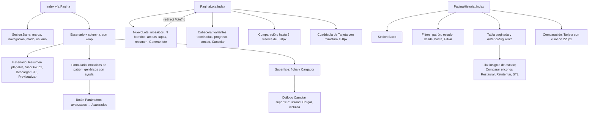
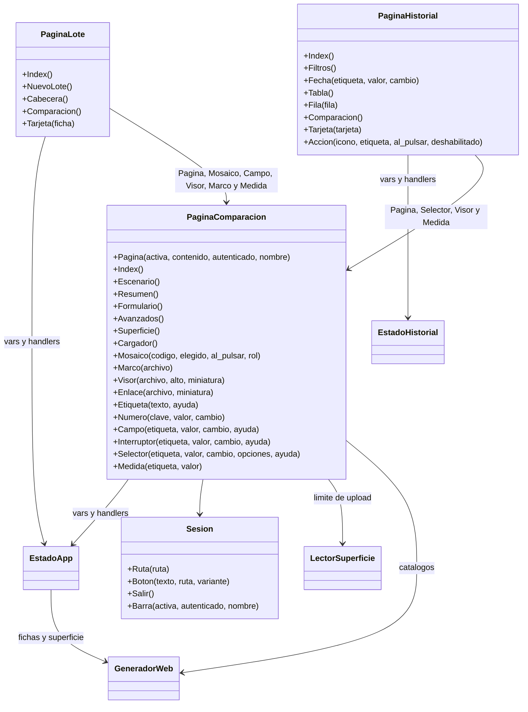

# Arquitectura del frontend Reflex

## Fuente y ejecución

Tres páginas: `/` ([`web/PaginaComparacion.py`](../../apps/web/web/PaginaComparacion.py), estado `EstadoApp`), `/lote` ([`web/PaginaLote.py`](../../apps/web/web/PaginaLote.py), mismo `EstadoApp`) y `/historial` ([`web/PaginaHistorial.py`](../../apps/web/web/PaginaHistorial.py), estado `EstadoHistorial`). Todas incluyen la barra de [`web/Sesion.py`](../../apps/web/web/Sesion.py). [`web/OrtesisLabApp.py`](../../apps/web/web/OrtesisLabApp.py) las registra en `rx.App`; [`rxconfig.py`](../../apps/web/rxconfig.py) selecciona plugins y tema. Reflex convierte ese árbol a React; el navegador no ejecuta `Model3DForPrinting` ni NumPy.

Las referencias `EstadoApp.pattern`, `EstadoApp.resultados`, etc. dentro de los componentes son expresiones reactivas. `rx.cond` decide contenido a partir del estado y `rx.foreach` genera repetidos. Los eventos `on_change`/`on_click` enlazan con métodos Python del servidor. Los arrays grandes quedan en el backend; React recibe textos, estados y `object_url` de STL. La arquitectura del framework se verifica en la [documentación oficial](https://reflex.dev/docs/advanced-onboarding/how-reflex-works/).

```mermaid
flowchart LR
  PY[PaginaComparacion, PaginaLote, PaginaHistorial, Sesion] --> COMP[Compilador Reflex]
  CFG[rxconfig y plugins] --> COMP
  COMP --> WEB[.web: React, Vite y React Router]
  WEB --> DOM[Componentes del navegador]
  DOM -->|on_change y on_click| EVT[Eventos Reflex]
  EVT --> ST[EstadoApp y EstadoHistorial en servidor]
  ST -->|Actualización de estado| DOM
  ST --> SRV[Servicios, PostgreSQL y trabajador]
  SRV --> STL[STL en el bucket S3]
  DOM -->|Recarga completa| AUTH[/auth/registro, /auth/login y /auth/logout]
  DOM --> FRAME[iframe /visor.html]
  FRAME -->|fetch object_url| STL
```

No hay un frontend separado escrito a mano en React ni un API client propio de generación. Sí hay JavaScript deliberado en `assets/visor/` (cargado por `visor.html`) y una expresión JS en `PaginaComparacion.Enlace`. Login/registro usan plantillas en `assets/auth/` ensambladas por `PlantillaAuth` (sin HTML embebido en la ruta Starlette). Lo generado bajo `.web/` se reemplaza al compilar: modificar las fuentes Python/HTML/JS para cambios duraderos.

## Sesión

`Sesion.Barra(activa, …)` es la navbar del shell (`header.ol-navbar` / `ol-navbar-inner` con margen seguro `--ol-safe`): marca OrtesisLab (enlace a `/`), navegación en píldora Diseño (`/`), Lotes (`/lote`) e Historial (`/historial`) con `aria-current="page"` en la ruta activa, modo claro/oscuro (`rx.toggle_color_mode`) y, con sesión, chip con iniciales/nombre más Cerrar sesión; sin sesión, Crear cuenta e Iniciar sesión. Esos botones recargan `<api_url>/auth/registro` o `/auth/login`. Cerrar sesión envía un POST a `/auth/logout` con un `<form>` HTML. `rx.el.form` cancela ese envío. Reflex compila las anclas como `Link` del enrutador y, sin recarga completa, mostraría su página 404 en vez de llegar al backend. La cookie `ortesislab_sesion` es HttpOnly; React nunca la lee. Al volver de cerrar sesión o al entrar otro usuario en la misma pestaña, `CargarPredeterminados` borra fichas, vistas y superficie y `EstadoHistorial` vacía filas y selección. En `/`, el `main` sin padding aloja un workspace a altura completa: escenario (`ol-stage`) y aside de parámetros (`ol-aside`, 440px).

## Árbol de componentes



## Clases y dependencias UML



## Estilos y dependencias

Aspecto del canvas «OrtesisLab Rediseño». Tema Radix: teal, gris sage, radio large; Tailwind V4 y sitemap como plugins. `rx.App` carga la fuente Manrope de Google Fonts y [`assets/ortesislab.css`](../../apps/web/assets/ortesislab.css), que define la paleta `--ol-*` para modo claro (`html .radix-themes`) y oscuro (`html.dark .radix-themes`), sustituye `--color-background`, `--color-panel-solid`, `--accent-9/10` y `--accent-contrast` de Radix y declara las clases `ol-card`, `ol-sub`, `ol-nav`, `ol-chip`, `ol-tile`, `ol-badge`/`ol-b-<estado>`, `ol-resumen` y `ol-tabla`. Las páginas ocupan todo el ancho con padding 20px. En `/` el escenario crece (`flex 999 1 640px`) y la columna mide `1 1 380px`; en `/lote` el formulario mide `1 1 340px` (máximo 400px) y el avance `999 1 640px`; la cuadrícula de tarjetas usa `repeat(auto-fill, minmax(240px, 1fr))`. Por debajo de 768px el Resumen deja de flotar. Botones de acción en píldora (`radius="full"`).

`reflex.lock/package.json` fija React/ReactDOM 19.2.8, React Router 8.4.0, Radix Themes 3.3.0, Vite 8.2.2 y Tailwind 4.3.0, entre otras dependencias. Son versiones observadas en ese lock, no recomendaciones de actualización. El visor usa Three.js 0.169.0 desde CDN y no comparte el tema de Reflex: su fondo es claro aunque se cambie color mode, también sobre el escenario oscuro del rediseño.

## Fronteras y riesgos actuales

Editar campos no reconstruye, cargar un archivo requiere botón y descargar no ejecuta la validación Blender. Durante generación se bloquean botones principales con `ocupado`; algunos controles siguen editables, pero la generación ya tomó su instantánea. Los lotes y el historial persisten en el servidor; recargar la página recupera el último lote. `/lote` muestra Cancelar lote mientras `ocupado`; la variante en curso termina antes de parar. No hay sincronización de cámaras de comparación.

`Enlace` usa `Var(_js_expr=..., _var_type=str, _var_data=...)` y `_get_all_var_data`, detalles internos de Reflex sensibles a migraciones. Cambiar la versión del framework requiere comprobar esa composición, upload, vars y background events, no solo que el paquete se importe.
