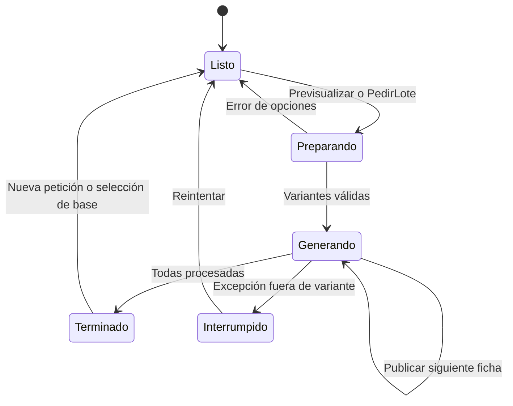

# Componentes, archivos y flujos de interfaz

## Catálogo de archivos

| Archivo/carpeta | Función |
|---|---|
| [`web/PaginaComparacion.py`](../../apps/web/web/PaginaComparacion.py) | Página `/` (Diseño): escenario con visor y Resumen, parámetros genéricos/avanzados con ayuda y superficie con diálogo de carga; helpers `Pagina`, `Mosaico`, `Campo`, `Selector`, `Visor` reutilizados por otras páginas |
| [`web/PaginaLote.py`](../../apps/web/web/PaginaLote.py) | Página `/lote`: formulario «Nuevo lote», avance del lote, comparación 3D y cuadrícula de tarjetas con miniatura por variante |
| [`web/PaginaHistorial.py`](../../apps/web/web/PaginaHistorial.py) | Página `/historial`: filtros, tabla paginada, acciones por versión y tarjetas de comparación |
| [`web/Sesion.py`](../../apps/web/web/Sesion.py) | Navbar (`header.ol-navbar`): marca, navegación, modo claro/oscuro, usuario e Iniciar/Cerrar sesión |
| [`web/OrtesisLabApp.py`](../../apps/web/web/OrtesisLabApp.py) | Páginas `/`, `/lote` e `/historial`, títulos y `on_load` |
| [`web/EstadoApp.py`](../../apps/web/web/EstadoApp.py) | Estado/handlers de `/` y `/lote` (comparten estado); se ejecutan en backend |
| [`web/EstadoHistorial.py`](../../apps/web/web/EstadoHistorial.py) | Estado/handlers de `/historial` |
| [`web/GeneradorWeb.py`](../../apps/web/web/GeneradorWeb.py) | Catálogos compartidos y fichas para mostrar; no renderiza |
| [`web/LectorSuperficie.py`](../../apps/web/web/LectorSuperficie.py) | Límite de subida usado por cliente y lector real servidor |
| [`web/__init__.py`](../../apps/web/web/__init__.py) | Marcador de paquete |
| [`rxconfig.py`](../../apps/web/rxconfig.py) | Plugins de compilación y apariencia |
| [`assets/ortesislab.css`](../../apps/web/assets/ortesislab.css) | Paleta clara/oscura, clases `ol-*`, helpers responsive (`ol-solo-*`) y empty states |
| [`assets/visor.html`](../../apps/web/assets/visor.html) | Cáscara del visor (enlace a CSS/JS en `/visor/`) |
| [`assets/visor/`](../../apps/web/assets/visor/) | Módulos ES del visor: tema, STL, cámara, controles, main |
| [`assets/auth/`](../../apps/web/assets/auth/) | Plantilla HTML/CSS de login y registro (`PlantillaAuth`) |
| [`web/services/PlantillaAuth.py`](../../apps/web/web/services/PlantillaAuth.py) | Rellena `auth.html` e incrusta `auth.css` en la respuesta API |
| [`assets/favicon.ico`](../../apps/web/assets/favicon.ico) | Icono del sitio |
| [`assets/superficie_interior_mm.npz`](../../apps/web/assets/superficie_interior_mm.npz) | Datos de ejemplo usados por backend; no componente visual |
| `reflex.lock/package.json`, `reflex.lock/bun.lock` | Dependencias JavaScript reproducibles |
| `.web/` | Compilación, dependencias instaladas y archivos públicos generados |

El [inventario global](../Agents/INVENTARIO.md) explica cada archivo auxiliar y los artefactos de `.web/`. [SIMBOLOS.md](SIMBOLOS.md) permite localizar todos los métodos.

## Componentes y bindings

| Método | Composición / conexiones |
|---|---|
| `Pagina` | Shell `ol-shell`: `Sesion.Barra` (navbar) + `<main class="ol-main">` con `h1` (`ol-sr-only`). Con `relleno=True` (Lotes/Historial) aplica `ol-main-pad`; Diseño usa `relleno=False` y el workspace a altura completa |
| `Index` | Workspace `ol-workspace`: `Escenario` (`ol-stage`) + `aside.ol-aside` (440px) con Formulario y Superficie en scroll |
| `Escenario` | Escenario a altura del viewport restante; rótulo de etapa; si hay `archivo`, `Resumen` + iframe en `ol-visor-slot`; si no, empty state; pie `ol-stage-actions` con mensaje/precio y Descargar / Previsualizar |
| `Resumen` | `<details open>` flotante con márgenes seguros: volumen, peso PETG, precio y detalle |
| `Formulario` | Bloque del aside (`ol-aside-block`): mosaicos Lucide (`role=radio`) → `set_pattern`; celda/nervadura; switch liner; avanzados; Restaurar; aviso voxel |
| `Avanzados` | Giro, marco, banda, paso de superficie, transición (con capa), semilla (si el patrón la pide) e invertir espesor |
| `Superficie` | Miniatura, nombre de `superficie_nombre`, `Cargador`, `superficie_detalle`, `espesor_total` y `superficie_error` |
| `Cargador` | Botón `ol-link-cta` «Cambiar archivo (STL o NPZ)» que abre `rx.dialog`: `rx.upload` ID `superficie-entrada`, badges de selección, Cargar archivo (`rx.upload_files`) y Usar superficie incluida |
| `Mosaico` | Botón con `rx.icon` Lucide (`ICONOS_PATRON`) y nombre de patrón; `aria-checked` (radio, Diseño) o `aria-pressed` (Lotes). Radiogroup + `TeclaPatron` en Diseño |
| `_GrupoTeclado` | Subclase de `Div` HTML con trigger `on_key_down` (el `rx.el.div` de fábrica no lo expone; no usar `rx.Component` + `tag="div"`, emite `jsx(div)` y rompe el prerender) |
| `Marco` | Wrapper flexible del visor de comparación, alto 320px |
| `Visor` | iframe con title, `loading=lazy` y URL de Enlace; `miniatura=True` pide un único fotograma |
| `Enlace` | `object_url` del STL → `/visor.html?src=${encodeURIComponent(url)}` (+ `&miniatura=1`) |
| `Etiqueta` | Texto y, si hay ayuda, icono `circle-help` enfocable con `rx.tooltip` y `aria_label` |
| `Numero` | `Campo` con etiqueta de `web.yaml` `ejes` y ayuda de `web.yaml` `ayudas` |
| `Campo` | `Etiqueta` y `rx.input(type='number')` controlado por cadena con `aria_label` |
| `Interruptor` | Switch booleano con `Etiqueta` (ayuda opcional) |
| `Selector` | `Etiqueta` y opciones `(codigo, etiqueta)` → `rx.select` controlado |
| `Medida` | Etiqueta pequeña y valor destacado |

### `/lote` (`PaginaLote`)

`/lote?id=<uuid>` abre ese lote; sin `id`, el último del usuario (`EstadoApp.AbrirLote` en `on_load`). Si el lote sigue abierto, `SeguirLote` consulta su avance.

| Método | Composición / conexiones |
|---|---|
| `Index` | Página título «Lotes»; NuevoLote y, a su lado, Cabecera, Comparacion y cuadrícula `auto-fill` (mín. 240px) de `Tarjeta` sobre `resultados`, o empty state si no hay variantes |
| `NuevoLote` | Patrones, N barridos, capa, `resumen_lote`; Generar lote → `PedirLote` (encola y no bloquea); plantillas: guardar/cargar/borrar/marcar y «Generar plantillas marcadas» |
| `FilaBarrido` | Una fila de `barridos`: selector de eje (`EJES`), ayuda, Desde/Hasta/Cada y quitar |
| `FilaPlantilla` | Checkbox, nombre, cargar y borrar una plantilla guardada |
| `Cabecera` | «hechos de total variantes terminadas» o «Sin lote abierto», `mensaje`; Cancelar lote (si `ocupado`) → `CancelarLote`; barra `porcentaje` y `resumen_estados` |
| `Comparacion` | Si `vistas` no está vacía: hasta tres visores interactivos (`Marco`); copy indica arrastre, rueda y flechas |
| `Tarjeta` | Miniatura 150px si hay STL; si no, error, spinner «Construyendo…» (`running`) o «En cola»; patrón, insignia `ol-b-<estado>` con textos `estados_visibles`, detalle, métricas; «Ver en 3D»/«Quitar de 3D» → `Comparar`; STL → `Descargar` |

### `/historial` (`PaginaHistorial`)

| Método | Composición / conexiones |
|---|---|
| `Index` | Página título «Historial»; Filtros, aviso `mensaje`, Tabla y Comparacion |
| `Filtros` | Selectores Patrón y Estado, fechas Desde/Hasta (flexibles) y botón Filtrar → `EstadoHistorial.Cargar` |
| `Fecha` | Etiqueta y `rx.input(type='date')` controlado |
| `Tabla` | Sin filas: empty state con enlace a Diseño. Con filas: en escritorio tabla (mín. 960px, clase `ol-solo-escritorio`); en ≤768px cards `TarjetaMovil` (`ol-solo-movil`); pie con paginación |
| `Fila` | Insignia `ol-b-<estado_codigo>`; `AccionesFila` (Comparar, Restaurar, Reintentar, Descargar) |
| `TarjetaMovil` | Misma información y acciones que la fila, en card para móvil |
| `AccionesFila` | Comparar/Quitar y botones de icono compartidos |
| `Accion` | `rx.icon_button` ≥40px con `aria_label` y tooltip |
| `Comparacion` | Si hay selección, cuadrícula `auto-fit` (mín. 280px) de tarjetas |
| `Tarjeta` | Versión, visor de 220px, patrón, diferencias de parámetros respecto de la primera elegida, métricas, intentos y nota |

### Barra de sesión (`Sesion`)

| Método | Composición |
|---|---|
| `Barra` | `<header class="ol-navbar">` con marca enlace a `/`, nav Diseño/Lotes/Historial (`aria-current`), modo claro/oscuro, chip usuario + `Salir`, o Crear cuenta/Iniciar sesión |
| `Boton` | `rx.button(as_child=True)` sobre un ancla con `reloadDocument` |
| `Salir` | Botón de icono dentro de `<form method="post">` nativo a `/auth/logout`. `rx.el.form` cancela el envío y cerrar sesión no saldría |
| `Ruta` | `api_url` de la configuración Reflex + ruta `/auth/*` |

## Reglas de visibilidad

| Condición | Resultado |
|---|---|
| `es_macizo` (el patrón no tiene celosía) | Muestra espesor macizo; oculta celda, nervadura, capa y, en avanzados, transición, giro, semilla, marco, banda y paso |
| Patrón con celosía | Muestra celda, nervadura y capa; con avanzados, giro, marco, banda y paso. La semilla solo si el patrón la pide |
| `avanzados=False` | Oculta la sección avanzada (sus valores siguen enviándose) |
| `liner=True` en retícula | Muestra espesor capa y espesor nominal total; con avanzados, transición |
| `liner=False` | Texto de rejilla abierta; altura es espesor total |
| `pattern=='VORONOI'` y avanzados | Muestra semilla |
| `barridos` no vacío | Lista de filas con ayuda y Desde/Hasta/Cada; producto cartesiano en `Combinaciones` |
| `lote_valido=False` | Aviso rojo con el motivo y Generar lote desactivado |
| `total>0` (en `/lote`) | Muestra progreso |
| `vistas.length()>0` (en `/lote`) | Muestra comparación 3D |
| `ocupado=True` | Previsualizar y Generar lote cargando/desactivados; carga/incluida y Restaurar desactivadas; en `/lote` aparece Cancelar lote |
| `subiendo_superficie=True` | Carga/incluida desactivadas; no constituye por sí solo un bloqueo de los botones de generación |

La web muestra posición de banda aunque su ancho sea cero; Blender la oculta en ese caso. La web informa `repair`/`resolution_mm` como texto, sin control editable; no aplica voxel. Todos los campos numéricos deben seguir siendo válidos aunque estén ocultos.

## Flujo de carga y generación

```mermaid
sequenceDiagram
  actor U as Usuario
  participant P as PaginaComparacion
  participant E as EstadoApp
  participant G as GeneradorWeb / ServicioImports
  participant L as ServicioLotes
  participant T as Trabajador
  U->>P: Elegir STL / NPZ
  P-->>U: Nombre seleccionado, aún no cargado
  U->>P: Cargar archivo
  P->>E: CargarSuperficie(upload_files)
  E->>G: GuardarSuperficie en thread (usuario de la cookie)
  alt Entrada válida
    G-->>E: Import ready; original y NPZ en el bucket
    E-->>P: Base nueva, vaciar resultados/vistas
  else Entrada inválida
    E-->>P: Error, conservar base previa
  end
  U->>P: Previsualizar
  P->>E: Previsualizar → Generar
  E->>L: Solicitar lote (request_id)
  loop Cada segundo
    E->>L: Progreso
    L-->>E: Ítems terminados
    E-->>P: Mensaje, porcentaje y fichas
  end
  T-->>L: Resultado confirmado, STL publicado
  P-->>U: iframe carga la object_url
```

Sin sesión, cada acción que toca datos muestra `Inicie sesión para continuar.`. Al cargar `/`, `CargarPredeterminados` aplica los valores por defecto solo la primera vez en la pestaña (volver desde `/lote` conserva lo editado; Restaurar los repone), vuelve a publicar el último lote del usuario y, si sigue abierto, retoma el seguimiento. En modo lote, `Generar` registra el lote, libera la UI (`ocupado=False`) y redirige a `/lote?id=<lote>` **sin** polling bloqueante; el worker construye solo. `AbrirLote` / `SeguirLote` consultan el avance bajo demanda. «Generar plantillas marcadas» encola hasta `maximo_pendientes` lotes. `resultados` refleja el lote abierto; `resumen_lote` / `lote_valido` usan `_Variantes(True)`.

## Flujo de historial

1. `on_load` → `EstadoHistorial.Cargar`: primera página de 25 versiones.
2. Cambiar filtros y pulsar Filtrar: recarga desde la página 1 con cursor nuevo.
3. Comparar en 2–3 filas: tarjetas con visor y lista de parámetros que difieren; la cuarta muestra `Compare hasta 3 versiones a la vez.`
4. Restaurar o Reintentar: encola un lote y redirige a `/lote`, que abre el último lote y sigue su progreso.
5. STL: registra la descarga y descarga desde la `object_url`.

## Estado de trabajo



Estos son estados conceptuales, no un enum del código. La implementación usa `ocupado`, `_trabajando`, `hechos`, `total`, `mensaje` y `lote_id`; el estado durable es el del lote en PostgreSQL. Errores individuales se muestran en su tarjeta y pueden coexistir con resultados válidos. Comparar alterna una URL entre hasta tres vistas; descargar usa la `object_url` sin modificar opciones ni regenerar.

## UX y accesibilidad observadas

Interfaz en español, inputs numéricos y componentes Radix. Cada ruta envuelve el contenido en `<main>` con un `h1` solo para lectores de pantalla. `Campo`, `Interruptor` y `Selector` nombran su control con `aria_label`; la ayuda usa `icon_button` ≥40px. El radiogroup de patrones en Diseño acepta flechas vía `TeclaPatron`. Las miniaturas tienen `tabindex=-1`. El visor interactivo ofrece arrastre, rueda y teclado (flechas, `+`/`-`, Home) en el iframe, sin botones de cámara; sincroniza tema claro/oscuro con el host cuando es same-origin. Historial usa cards bajo 768px. `/auth/*` reutiliza la paleta `--ol-*` (CSS inline) y `autocomplete` distinto en registro (`new-password`).

No hay auditoría WCAG formal automatizada en CI. Mensajes de error por campo, descarga de ficha JSON y cámaras sincronizadas entre iframes siguen como oportunidades futuras.
