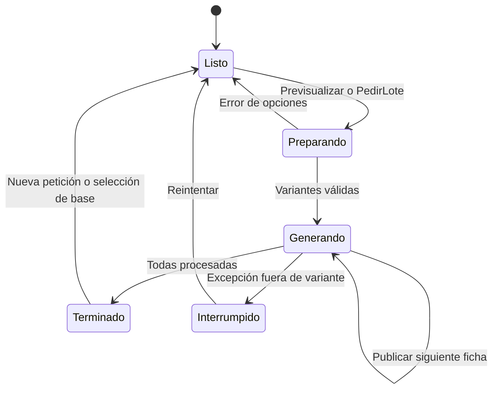

# Componentes, archivos y flujos de interfaz

## Catálogo de archivos

| Archivo/carpeta | Función |
|---|---|
| [`web/PaginaComparacion.py`](../../apps/web/web/PaginaComparacion.py) | Página `/`: superficie, parámetros genéricos/avanzados con ayuda, pestañas «Una ortesis» y «Lote de variantes»; helpers `Campo`, `Selector`, `Visor` reutilizados por otras páginas |
| [`web/PaginaLote.py`](../../apps/web/web/PaginaLote.py) | Página `/lote`: avance del lote, comparación 3D y cuadrícula de tarjetas con miniatura por variante |
| [`web/PaginaHistorial.py`](../../apps/web/web/PaginaHistorial.py) | Página `/historial`: filtros, tabla paginada, acciones por versión y tarjetas de comparación |
| [`web/Sesion.py`](../../apps/web/web/Sesion.py) | Barra común: navegación, nombre y botón Iniciar/Cerrar sesión |
| [`web/OrtesisLabApp.py`](../../apps/web/web/OrtesisLabApp.py) | Páginas `/`, `/lote` e `/historial`, títulos y `on_load` |
| [`web/EstadoApp.py`](../../apps/web/web/EstadoApp.py) | Estado/handlers de `/` y `/lote` (comparten estado); se ejecutan en backend |
| [`web/EstadoHistorial.py`](../../apps/web/web/EstadoHistorial.py) | Estado/handlers de `/historial` |
| [`web/GeneradorWeb.py`](../../apps/web/web/GeneradorWeb.py) | Catálogos compartidos y fichas para mostrar; no renderiza |
| [`web/LectorSuperficie.py`](../../apps/web/web/LectorSuperficie.py) | Límite de subida usado por cliente y lector real servidor |
| [`web/__init__.py`](../../apps/web/web/__init__.py) | Marcador de paquete |
| [`rxconfig.py`](../../apps/web/rxconfig.py) | Plugins de compilación y apariencia |
| [`assets/visor.html`](../../apps/web/assets/visor.html) | Documento independiente Three.js dentro de iframe |
| [`assets/favicon.ico`](../../apps/web/assets/favicon.ico) | Icono del sitio |
| [`assets/superficie_interior_mm.npz`](../../apps/web/assets/superficie_interior_mm.npz) | Datos de ejemplo usados por backend; no componente visual |
| `reflex.lock/package.json`, `reflex.lock/bun.lock` | Dependencias JavaScript reproducibles |
| `.web/` | Compilación, dependencias instaladas y archivos públicos generados |

El [inventario global](../Agents/INVENTARIO.md) explica cada archivo auxiliar y los artefactos de `.web/`. [SIMBOLOS.md](SIMBOLOS.md) permite localizar todos los métodos.

## Componentes y bindings

| Método | Composición / conexiones |
|---|---|
| `Index` | Barra de sesión, título, explicación; columna izquierda Superficie + Formulario, derecha Acciones |
| `Formulario` | Parámetros genéricos (patrón, celda, nervadura, capa interior, espesor macizo) → `EstadoApp.<campo>`; casilla «Mostrar parámetros avanzados» → `avanzados`; Restaurar → `RestaurarPredeterminados` |
| `Avanzados` | Transición, giro, semilla, marco, banda, paso de superficie e invertir espesor |
| `Acciones` | `rx.tabs`: «Una ortesis» (`Vista`) y «Lote de variantes» (`Lote`) |
| `Superficie` | Tarjeta con `rx.upload` ID `superficie-entrada`; badges de selección; carga con `rx.upload_files`; botón incluida; avisos y metadatos |
| `Vista` | Previsualizar → `EstadoApp.Previsualizar` y `mensaje`; si `archivo` no vacío: iframe 520px, detalle, volumen/peso/precio, alcance; si vacío: placeholder |
| `Lote` | Pasos 1–3: casillas de patrones (`Casilla`), parámetro a variar con su ayuda y Desde/Hasta/Cada, ambas capas; aviso `resumen_lote` (verde si `lote_valido`); «Generar lote y ver progreso» → `PedirLote`, que redirige a `/lote?id=<lote>`; enlace al último lote |
| `Casilla` | Tarjeta con checkbox y etiqueta de un patrón |
| `Marco` | Wrapper flexible del visor de comparación, alto 320px |
| `Visor` | iframe con title, `loading=lazy` y URL de Enlace; `miniatura=True` pide un único fotograma |
| `Enlace` | `object_url` del STL → `/visor.html?src=${encodeURIComponent(url)}` (+ `&miniatura=1`) |
| `Etiqueta` | Texto y, si hay ayuda, icono `info` enfocable con `rx.tooltip` y `aria_label` |
| `Numero` | `Campo` con etiqueta de `web.yaml` `ejes` y ayuda de `web.yaml` `ayudas` |
| `Campo` | `Etiqueta` y `rx.input(type='number')` controlado por cadena con `aria_label` |
| `Interruptor` | Switch booleano con `Etiqueta` (ayuda opcional) |
| `Selector` | `Etiqueta` y opciones `(codigo, etiqueta)` → `rx.select` controlado |
| `Medida` | Etiqueta pequeña y valor destacado |

### `/lote` (`PaginaLote`)

`/lote?id=<uuid>` abre ese lote; sin `id`, el último del usuario (`EstadoApp.AbrirLote` en `on_load`). Si el lote sigue abierto, `SeguirLote` consulta su avance.

| Método | Composición / conexiones |
|---|---|
| `Index` | Barra de sesión, título, Cabecera, Comparacion y cuadrícula responsive (1–4 columnas) de `Tarjeta` sobre `resultados` |
| `Cabecera` | `mensaje`; Cancelar lote (si `ocupado`) → `CancelarLote`; Nuevo lote → `/`; barra `porcentaje`, «hechos de total terminadas» y `resumen_estados` |
| `Comparacion` | Si `vistas` no está vacía: hasta tres visores interactivos (`Marco`) |
| `Tarjeta` | Miniatura 200px si hay STL; si no, error, spinner «Construyendo…» (`running`) o «En cola»; patrón, insignia de estado (`COLORES_ESTADO`, textos `estados_visibles`), detalle, métricas; «Ver en 3D»/«Quitar de 3D» → `Comparar`; STL → `Descargar` |

### `/historial` (`PaginaHistorial`)

| Método | Composición / conexiones |
|---|---|
| `Index` | Barra de sesión, título, explicación, Filtros, aviso `mensaje`, Tabla y Comparacion |
| `Filtros` | Selectores Patrón (200px) y Estado (160px), fechas Desde/Hasta y botón Filtrar → `EstadoHistorial.Cargar` |
| `Fecha` | Etiqueta y `rx.input(type='date')` controlado |
| `Tabla` | Columnas Versión, Fecha, Patrón, Parámetros, Estado, Volumen, Peso, Precio y acciones; Anterior/Siguiente con número de página |
| `Fila` | Comparar/Quitar → `Seleccionar`; Restaurar; Reintentar; STL → `Descargar` (desactivado sin URL); aviso rojo si el archivo falta |
| `Comparacion` | Si hay selección, tarjetas lado a lado |
| `Tarjeta` | Versión, patrón, métricas, diferencias de parámetros respecto de la primera elegida y visor de 320px |

### Barra de sesión (`Sesion`)

| Método | Composición |
|---|---|
| `Barra` | Enlaces Comparar, Lote e Historial, nombre y botón de sesión según `autenticado` |
| `Boton` | `rx.button(as_child=True)` sobre un ancla con `reloadDocument` |
| `Ruta` | `api_url` de la configuración Reflex + ruta `/auth/*` |

## Reglas de visibilidad

| Condición | Resultado |
|---|---|
| `pattern=='SOLID'` | Muestra espesor macizo; oculta celda, nervadura, capa y, en avanzados, transición, giro, semilla, marco, banda y paso |
| Patrón distinto de SOLID | Muestra celda, nervadura y capa; con avanzados, giro, marco, banda y paso |
| `avanzados=False` | Oculta la sección avanzada (sus valores siguen enviándose) |
| `liner=True` en retícula | Muestra espesor capa y espesor nominal total; con avanzados, transición |
| `liner=False` | Texto de rejilla abierta; altura es espesor total |
| `pattern=='VORONOI'` y avanzados | Muestra semilla |
| `eje!='ninguno'` | Muestra la ayuda del parámetro y Desde/Hasta/Cada |
| `lote_valido=False` | Aviso rojo con el motivo y Generar lote desactivado |
| `total>0` (en `/lote`) | Muestra progreso |
| `vistas.length()>0` (en `/lote`) | Muestra comparación 3D |
| `ocupado=True` | Previsualizar y Generar lote cargando/desactivados; carga/incluida y Restaurar desactivadas; en `/lote` aparece Cancelar lote |
| `subiendo_superficie=True` | Carga/incluida desactivadas; no constituye por sí solo un bloqueo de los botones de generación |

La web muestra posición de banda aunque su ancho sea cero; Blender la oculta en ese caso. La web informa `repair`/`resolution_mm` como texto, sin control editable; no aplica voxel. Todos los campos numéricos deben seguir siendo válidos aunque estén ocultos.

## Flujo de carga y generación

```mermaid
sequenceDiagram
  actor U as Usuario
  participant P as PaginaComparacion
  participant E as EstadoApp
  participant G as GeneradorWeb / ServicioImports
  participant L as ServicioLotes
  participant T as Trabajador
  U->>P: Elegir STL / NPZ
  P-->>U: Nombre seleccionado, aún no cargado
  U->>P: Cargar archivo
  P->>E: CargarSuperficie(upload_files)
  E->>G: GuardarSuperficie en thread (usuario de la cookie)
  alt Entrada válida
    G-->>E: Import ready; original y NPZ en el bucket
    E-->>P: Base nueva, vaciar resultados/vistas
  else Entrada inválida
    E-->>P: Error, conservar base previa
  end
  U->>P: Previsualizar
  P->>E: Previsualizar → Generar
  E->>L: Solicitar lote (request_id)
  loop Cada segundo
    E->>L: Progreso
    L-->>E: Ítems terminados
    E-->>P: Mensaje, porcentaje y fichas
  end
  T-->>L: Resultado confirmado, STL publicado
  P-->>U: iframe carga la object_url
```

Sin sesión, cada acción que toca datos muestra `Inicie sesión para continuar.`. Al cargar `/`, `CargarPredeterminados` aplica los valores por defecto solo la primera vez en la pestaña (volver desde `/lote` conserva lo editado; Restaurar los repone), vuelve a publicar el último lote del usuario y, si sigue abierto, retoma el seguimiento. En modo lote, `Generar` redirige a `/lote?id=<lote>` tras registrarlo y sigue publicando su avance; si la pestaña abre otro lote, `_Seguir` se detiene y `AbrirLote` sigue el nuevo. `resultados` contiene todas las variantes con su `estado` (también en cola o en curso); `resumen_lote` y `lote_valido` calculan el lote con `_Variantes(True)` en cada cambio.

## Flujo de historial

1. `on_load` → `EstadoHistorial.Cargar`: primera página de 25 versiones.
2. Cambiar filtros y pulsar Filtrar: recarga desde la página 1 con cursor nuevo.
3. Comparar en 2–3 filas: tarjetas con visor y lista de parámetros que difieren; la cuarta muestra `Compare hasta 3 versiones a la vez.`
4. Restaurar o Reintentar: encola un lote y redirige a `/lote`, que abre el último lote y sigue su progreso.
5. STL: registra la descarga y descarga desde la `object_url`.

## Estado de trabajo



Estos son estados conceptuales, no un enum del código. La implementación usa `ocupado`, `_trabajando`, `hechos`, `total`, `mensaje` y `lote_id`; el estado durable es el del lote en PostgreSQL. Errores individuales se muestran en su tarjeta y pueden coexistir con resultados válidos. Comparar alterna una URL entre hasta tres vistas; descargar usa la `object_url` sin modificar opciones ni regenerar.

## UX y accesibilidad observadas

Interfaz en español, inputs numéricos y componentes Radix; no hay evidencia de una auditoría WCAG completa. `Campo`, `Interruptor` y `Selector` nombran su control con `aria_label`; la ayuda de cada parámetro se abre desde un botón de icono enfocable. Las miniaturas tienen `tabindex=-1`: la interacción por teclado está en la comparación 3D. El iframe tiene título pero el canvas no ofrece descripción geométrica textual ni controles de cámara por teclado implementados. La tabla permite scroll horizontal y los bloques hacen wrap, pero tamaños mínimos pueden causar desbordes en pantallas estrechas.

La ausencia de mensajes de error por campo, descarga de ficha JSON y cámaras sincronizadas describe el estado actual; son oportunidades futuras, no funciones ya desarrolladas.
