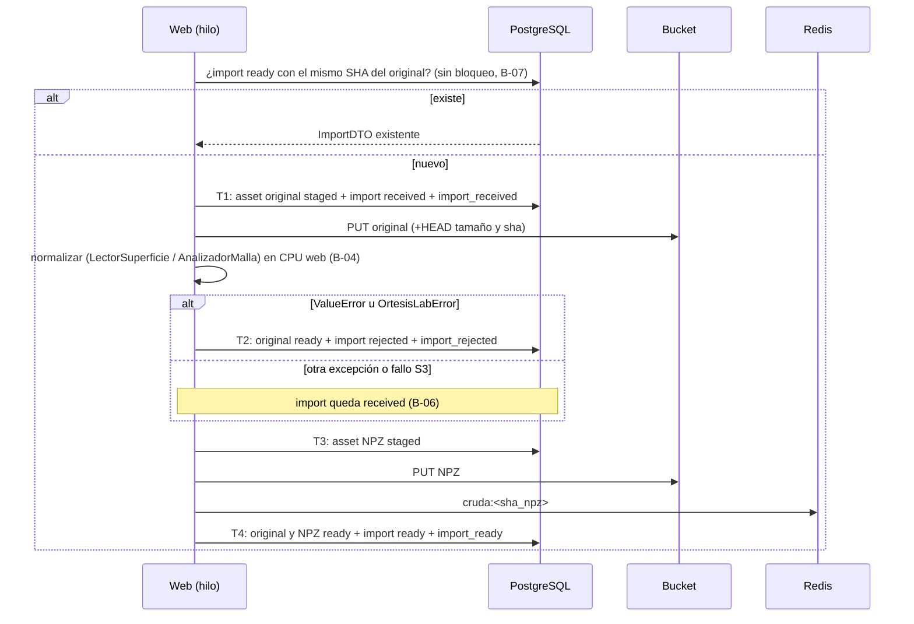
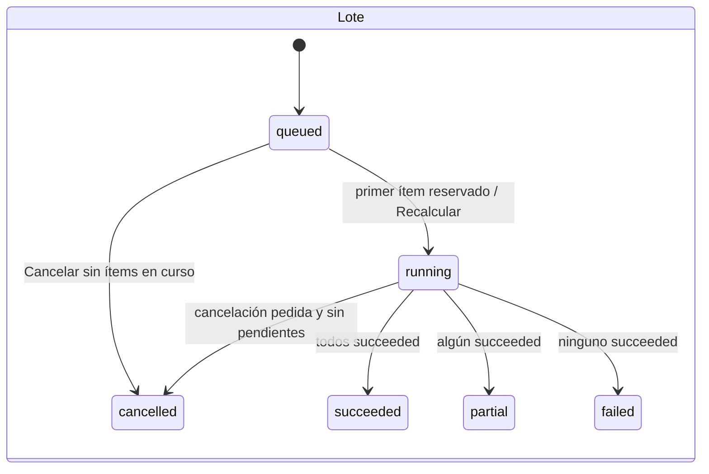

# Backend · Servicios, flujos y máquinas de estado

**Estado:** propuesta. Implementado en `e56df68`, pero **no importable** por
B-01: `ServicioImports`, `ServicioLotes` y `ServicioVersiones` fallan al
importarse. **Archivos:** `web/services/**`, `web/jobs/**`, `web/GeneradorWeb.py`,
`web/LectorSuperficie.py`.

## Servicios: ficha por método

### `ContextoUsuario` (`web/services/ContextoUsuario.py`)

| Método | E → S | P / Ef | Err |
|---|---|---|---|
| `Hash(token)` | str → hex SHA-256 | Codifica en ASCII | `UnicodeEncodeError` si el token no es ASCII |
| `TokenDeCookie(cabecera)` | Cabecera `Cookie` → token o `""` | `SimpleCookie`; un `CookieError` devuelve `""` | — |
| `Requerir(cabecera)` | → `UsuarioAutenticado` | Una transacción: `ResolverSesion` + `Predeterminado`, que **puede crear** el proyecto | `SesionInvalida` (sin token, sesión vencida, revocada o cuenta inactiva); `PersistenciaNoDisponible` |
| `IniciarSesion(iss, sub, email, nombre)` | → `(token, expira)` | Una transacción: `Upsert`, comprobación de `active`, preferencias, proyecto y sesión. Token `secrets.token_urlsafe(32)`; se guarda su SHA | `SesionInvalida("La cuenta no está activa.")` |
| `CerrarSesion(cabecera)` | — | Revoca por SHA si hay token | — |
| `Activar(usuario)` (context manager) / `Actual()` | — / → usuario | `ContextVar` para código heredado sin usuario en la firma | `Actual`: `SesionInvalida` si no hay usuario |

### `AutenticacionOidc.Aplicacion()` → `Starlette`

Monta `/auth` con `authlib` (descubrimiento
`<issuer>/.well-known/openid-configuration`, alcance `openid email profile`).

| Ruta | Método HTTP | Comportamiento |
|---|---|---|
| `/auth/login` | GET | `authorize_redirect` a `ORTESISLAB_OIDC_REDIRECT_URI`; `state` y `nonce` en la cookie firmada `ortesislab_oidc` (600 s) |
| `/auth/callback` | GET | `authorize_access_token`. `OAuthError` → 400. Sin `sub`/`iss` en `userinfo` → 400. Nombre: `name` → `preferred_username` → `email` → `sub`. `IniciarSesion` en hilo; `ErrorPersistencia` → 503. Éxito: 303 a `app_url` con cookie `ortesislab_sesion` (HttpOnly, SameSite=Lax, `Secure` según configuración, 12 h) |
| `/auth/logout` | GET | Revoca (ignora `ErrorPersistencia`), borra la cookie, 303 a `app_url` (B-15) |

### `ServicioImports` (`web/services/ServicioImports.py`)

| Método | Contrato |
|---|---|
| `NombreSuperficie(asset_id)` | `superficie-<32 hex>.npz` |
| `AssetDeNombre(nombre)` | Inverso; `ValueError` si el formato no es exacto (hexadecimal en minúsculas) |
| `TuplaANpz(tupla)` / `NpzATupla(bytes, nombre)` | Serializa con `savez_compressed` (`vertices`, `faces`, `normals`, `border`) / carga sin pickle; `ArchivoSuperficieIlegible` |
| `PrepararPlantilla(bytes)` | `AnalizadorMalla.Preparar(..., suavizarNormales=False)` sobre el NPZ incluido |
| `Importar(usuario, nombre, contenido, autoescalar)` | Valida extensión, vacío y tamaño, y detecta STL binario por `84 + 50·n == len`. Llama a `_Registrar` con normalización **sin autoescala** (la escala se decide al generar). Devuelve `(ImportDTO, info)` |
| `AsegurarPlantilla(usuario)` | Registra la plantilla como import `included_template` del usuario (deduplicado por SHA) |
| `Resolver(usuario, superficie_archivo)` | `""` → plantilla; si no, import `ready` por NPZ normalizado; `AccesoDenegado` si no existe |
| `Info(import, nombre, autoescalar)` | Resumen para la UI: dimensiones × factor, aviso de escala |
| `_Registrar(...)` | Ver el flujo de importación |

### `ServicioVersiones`

| Método | Contrato |
|---|---|
| `Canonico(valor)` | JSON con claves ordenadas, sin espacios, `allow_nan=False` (`ValueError` con NaN) |
| `Sha(valor)` | SHA-256 de `Canonico` |
| `Material()` | Instantánea PETG: `name`, `density_g_cm3` 1.27, `price_per_gram` 0.15, `currency` `None`, `color`, `kind`, `brand` |
| `Parametros(opciones)` | `ParametrosDefecto() | opciones`; `ParametrosNoReconocidos` con claves extra. **No valida rangos**: la validación geométrica ocurre en el trabajador |
| `Insertar(c, usuario, project_id, import_id, variantes, auto_scale, padre?, nota?)` | Reserva n números, inserta una versión por variante con `sha({parameters, auto_scale, backend})` y emite `version_created` por versión. Usa `ESQUEMA_PARAMETROS` (no definido, B-01) |

### `ServicioPreferencias`

`Obtener(usuario)` y `GuardarAutoescala(usuario, auto_scale, revision)`.
Conserva `default_parameters` y lanza `ConflictoRevision` si la revisión cambió.

### `ServicioLotes` (lado web)

| Método | Contrato |
|---|---|
| `HuellaSolicitud(s)` | SHA de `import_id`, `mode`, `definition`, `variantes`, `auto_scale`, `parent_version_id`, `version_ids` |
| `Solicitar(usuario, s)` | `total ∈ [1, MAXIMO_ITEMS_LOTE]` (si no, `CuotaExcedida`). En **una** transacción: advisory lock del usuario → idempotencia (mismo SHA devuelve el lote previo; distinto → `SolicitudIdempotenteEnConflicto`) → cuota de pendientes → import `ready` → versiones (o las existentes en `retry`, que deben ser del mismo proyecto) → lote → ítems → `batch_queued` |
| `Progreso(usuario, batch_id)` | Lote e ítems (lectura) |
| `Ultimo(usuario)` | Último lote, o `None` |
| `Esperar(usuario, batch_id, limite_s, intervalo_s=1)` | Sondeo bloqueante con `time.sleep` (B-10) |
| `Cancelar(usuario, batch_id)` | Bloquea el lote → `SolicitarCancelacion` → `batch_cancel_requested` → `Recalcular`. `False` si ya estaba cerrado o cancelado |

### `ServicioLotes` (lado trabajador)

| Método | Contrato |
|---|---|
| `Reservar(id, lease_s, generador, revision, runtime)` | `ReservarPendiente` en una transacción |
| `Renovar(trabajo, lease_s)` / `CancelacionPedida(trabajo)` | Una transacción cada una |
| `RegistrarSalidas(trabajo, [(asset_id, clave, kind, media, tamaño, sha)])` | Filas `staged` **antes** de subir |
| `Confirmar(trabajo, resultado, stl, json, ms)` | Si `BloquearVigente`: assets → `ready`, resultado, exports STL y JSON (con `VERSION_EXPORTADOR`, no definido, B-01), `Exito`, `result_ready`, `Recalcular`. Si no, `False` |
| `Fallar(trabajo, codigo, mensaje, reintentable, ms)` | Si el lease sigue vigente: cierra el intento como `failed`, `Liberar` con espera `5 × 2^(n-1)`, `attempt_failed`, `Recalcular`. Devuelve el nuevo estado del ítem o `None` |
| `CerrarCancelado(trabajo, ms)` | Intento `cancelled`, ítem `cancelled`, `Recalcular` |
| `AbandonarVencidos()` | Para cada `Vencidos`: intento `abandoned`, `Liberar(reintentar=True, 0)`, `attempt_abandoned`, `Recalcular` |

### `ServicioHistorial`

| Método | Contrato |
|---|---|
| `CodificarCursor` / `DecodificarCursor` | Base64 URL de `"<iso>|<uuid>"`; `ValueError` si no es válido. **No** está firmado; cada consulta vuelve a filtrar por usuario |
| `Listar(usuario, filtros, cursor?, limite=25)` | Acota el límite a `[1, 100]`; `status` debe pertenecer a `EstadoItem` |
| `Detalle(usuario, version_id)` | Versión, import, parámetros del padre, intentos, resultados y eventos |
| `Comparar(usuario, ids)` | De 1 a 3 `Detalle` (una transacción por versión) |
| `Restaurar(usuario, version_id, request_id?)` | Lote `single` con los mismos parámetros, `parent_version_id` y nota «Restaurada desde la versión N.» |
| `Reintentar(usuario, ids, request_id?)` | Lote `retry`; todas las versiones deben compartir import (`AccesoDenegado`) |
| `RegistrarDescarga(usuario, asset_id)` | Export STL del usuario en `ready` con URL → `export_downloaded` → URL |

### `GeneradorGeometrico.Construir(opciones, superficie_archivo, autoescalar, material)`

- **E:** las 17 opciones, el nombre `superficie-<hex>.npz`, la autoescala y la
  instantánea de material.
- **P:**
  - `SOLID`: superficie escalada sin refinar.
  - Otro patrón: `RefinadorMalla.PasoPatron(opciones)` y superficie refinada con
    caché.
  - Después, `Model3DForPrinting(MaterialDe(material)).Construir(...)`, volumen,
    peso, precio y `GeneradorWeb.Stl`.
- **S:** `(ResultadoGeometrico, stl_bytes, json_bytes)`. El JSON canónico lleva
  `units`, `geometry_scope`, `parameters`, `auto_scale`, `scale`, `material` y
  `metrics`.
- **Err:** `OrtesisLabError`.
- **Requisito:** debe haber un usuario activo en `ContextoUsuario`, porque la
  superficie se lee de su asset.

### `GeneradorWeb` (`web/GeneradorWeb.py`)

| Método | Contrato |
|---|---|
| `_Origen(archivo)` | `""` → (SHA de la plantilla, cargador). Si no, el asset del usuario debe ser `ready` y `surface_npz` (`ArchivoSuperficieNoEncontrado`); cargador `LeerVerificado` |
| `Cruda(archivo)` | Redis `cruda:<sha>` o carga y guarda |
| `EjeMayor(archivo)` | `max(ptp(vértices))` |
| `_SuperficieConDiagnostico(archivo, autoescalar)` | Copia, `EscalaMalla.Resolver` y aplica el factor a puntos y borde |
| `_SuperficieRefinadaConDiagnostico(archivo, paso, autoescalar)` | Redis `refinada:<sha>:<paso>:<0/1>` + `diagnostico:<sha>:<0/1>:<paso>`; si falta alguna, `EscalaMalla.Aplicar` con `RefinadorMalla.Refinar` |
| `GuardarSuperficie(nombre, bytes, autoescalar)` | `ServicioImports.Importar` del usuario activo → nombre interno e información |
| `Crear(opciones, archivo, autoescalar)` | Lote `single` y espera de hasta 600 s; ficha o `FichaError` por timeout |
| `_FichaDeItem(item)` | Ficha del ítem: STL `ready`, «El STL ya no está en el almacén.», «Cancelada.» o el error (máximo 180 caracteres) |
| `Ficha`, `FichaError`, `Detalle`, `Numero` | Textos en español; `Numero` usa punto de miles y coma decimal |
| `Combinaciones(base, patrones, eje, desde, hasta, paso, ambos)` | Ver [contratos de variantes](#barrido-de-variantes) |
| `Stl(vertices, caras)` / `Triangulos(caras)` | STL binario en float32 (A-15) / abanico de polígonos |
| `Escribir`, `Leer`, `Ruta`, `RutaSuperficie` | Acceso a objetos del usuario activo por `object_url` o nombre; `Ruta` exige la URL exacta del almacén y el `user_id` de la sesión |

### Barrido de variantes

`GeneradorWeb.Combinaciones` se describe paso a paso:

1. Necesita al menos un patrón conocido; el eje es `""`, `ninguno` o una clave de
   `web.ejes`.
2. `multiplicador = Σ (1 si SOLID o no ambos, 2 si no)`.
3. Si hay eje, desde, hasta y paso deben ser finitos, con `paso > 0` y
   `desde ≤ hasta`. Para `seed` se exigen enteros no negativos.
4. Se rechaza **antes** de materializar si
   `hasta − desde ≥ paso × (maximo_variantes // multiplicador)`.
5. Los valores se calculan con `Decimal(str(x))`, de modo que el extremo
   `hasta` se incluye si se alcanza exactamente.
6. El orden de salida es patrón → valor → capa `[True, False]`; `SOLID` conserva
   su `liner`.
7. Comprobación final: `len ≤ maximo_variantes`.

## Flujo de importación (`ServicioImports._Registrar`)

## Ciclo del trabajador (`TrabajadorGeneracion`)

`Ejecutar(detener, espera_s=2)` es el bucle principal:

1. Si han pasado `supervision_s`, ejecuta `AbandonarVencidos`.
2. Si han pasado `conciliacion_s`, ejecuta `ConciliadorArchivos.Ejecutar`.
3. Ejecuta `Ciclo()`; si procesó algo, repite sin esperar.
4. Si no, espera 2 s.

Un `ErrorPersistencia` se registra como advertencia y el bucle continúa.

`Procesar(trabajo)` sigue estos pasos:

1. Arranca el hilo de latido, que cada `latido_s` llama a `Renovar`. Si el lease
   se perdió, activa `perdido`; un `ErrorPersistencia` se registra y el latido
   sigue.
2. Construye la geometría con `ContextoUsuario.Activar(usuario sintético)`.
3. Si se perdió el lease, termina sin publicar.
4. Si se pidió cancelación, ejecuta `CerrarCancelado`.
5. Registra las salidas `staged`, sube el STL (con `Content-Disposition`) y el
   JSON, y ejecuta `Confirmar`. Si devuelve `False`, solo lo registra en el log.

Matriz de excepciones:

| Excepción | Acción | ¿Reintentable? |
|---|---|---|
| `OrtesisLabError` (parámetros o geometría) | `Fallar` | No: el ítem queda `failed` |
| `ErrorPersistencia` (base o S3) | `_FallarSinPerder`; si tampoco hay base, el lease vence | Sí |
| Cualquier otra | `Fallar(codigo="error_interno")` | No |

`scripts/EjecutarTrabajador.py` crea `Almacen.Actual()` (falla si faltan
variables S3) y abre un pool de 1–2 conexiones. `--una-vez` vacía la cola sin
supervisión ni conciliación. SIGINT y SIGTERM activan `detener`.

## Conciliación (`ConciliadorArchivos.Ejecutar`)

Cada pasada hace, en orden, lo siguiente y devuelve los conteos
`{staged, rechazados, ausentes, huerfanos}`:

1. Assets `staged` con más de 24 h: borra el objeto si existe y marca `deleted`.
   Máximo 200 por pasada.
2. Assets de imports `rejected` con más de 30 días: borra el objeto y marca
   `deleted`. Máximo 200.
3. Hasta 200 assets `ready` (cursor por id): sin objeto, el asset y sus exports
   pasan a `missing`.
4. Lista todo `usuarios/` en bloques de 500. Un objeto sin fila con más de 24 h
   se borra.

## Máquinas de estado

| Entidad | Transición | Disparador (método) |
|---|---|---|
| Ítem | `queued → running` | `ReservarPendiente` |
| Ítem | `running → succeeded` | `Exito` (desde `Confirmar`) |
| Ítem | `running → queued` | `Liberar(reintentar=True)` con intentos restantes (`Fallar` reintentable o `AbandonarVencidos`) |
| Ítem | `running → failed` | `Liberar` sin intentos o no reintentable |
| Ítem | `running → cancelled` / `queued → cancelled` | `Liberar` con cancelación pedida / `SolicitarCancelacion` |
| Intento | `running → succeeded/failed/cancelled/abandoned` | `Exito` / `CerrarIntento` / `AbandonarIntento` |
| Asset | `staged → ready` | `MarcarListo` |
| Asset | `staged → deleted`, `ready → missing`, `ready → deleted` (rechazados) | Conciliador |
| Import | `received → ready` / `received → rejected` | `_Registrar` (T4 / T2) |
| Export | `ready → missing` | Conciliador |
| Preferencias | `revision n → n+1` | `Guardar` |

Estados sin productor en el código: `EstadoAsset.quarantined` y `deleting`,
`EstadoImport.validating`, `EstadoUsuario.deletion_pending` y
`EstadoValidacion.passed/failed` en la web.

## Eventos de historial

| `event_type` | Emisor | Transacción | `payload` |
|---|---|---|---|
| `import_received` | `ServicioImports._Registrar` | T1 | `import_id`, `name`, `size_bytes` |
| `import_ready` | ídem | T4 | `import_id`, `vertices`, `faces` |
| `import_rejected` | ídem | T2 | `import_id`, `error_code` |
| `version_created` | `ServicioVersiones.Insertar` | Admisión del lote | `version_number`, `pattern` |
| `batch_queued` | `ServicioLotes.Solicitar` | Admisión | `mode`, `total_items` |
| `batch_cancel_requested` | `ServicioLotes.Cancelar` | Cancelación | `{}` |
| `batch_finished` | `RepositorioLotes.Recalcular` | Cualquiera que cierre | `status`, `succeeded`, `total` |
| `attempt_started` | `ReservarPendiente` | Reserva | `attempt_number`, `worker_id` |
| `attempt_failed` | `ServicioLotes.Fallar` | Fallo | `attempt_number`, `error_code`, `retryable` |
| `attempt_abandoned` | `AbandonarVencidos` | Supervisión | `attempt_count` |
| `result_ready` | `ServicioLotes.Confirmar` | Confirmación | `volume_mm3`, `weight_g` |
| `export_downloaded` | `ServicioHistorial.RegistrarDescarga` | Descarga | `{}` |
| `project_archived` | **Ningún emisor** | — | — |

No hay ningún evento al cancelar un intento (`CerrarCancelado`) ni al pasar un
asset a `missing`.
