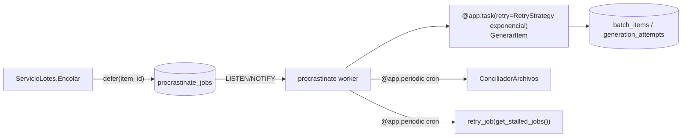
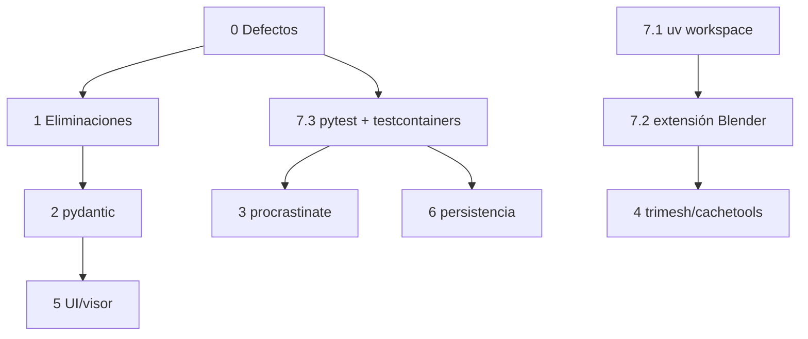

# Plan de simplificación con librerías

**Fecha:** 2026-11-12. **Estado:** propuesta. Nada de este plan está implementado.
**Base:** [INVESTIGACION_LIBRERIAS.md](INVESTIGACION_LIBRERIAS.md).

## Requisito previo: bloqueo de auditoría

Todos los archivos de código citados aquí están en los inventarios de
`AUD-2026-10-13-001` o de `AUD-2026-10-29-002`. Cada fase necesita tres cosas:

1. Una instrucción explícita del usuario que la habilite.
2. Un registro `EN_CURSO` en `docs/Audit/resolves/`, con los archivos y el
   alcance, **antes** de editar.
3. El cierre de ese registro con evidencia de las pruebas ejecutadas.

Este plan **no** es esa autorización (ver [docs/Audit/README.md](../Audit/README.md)).
Hay un rediseño de lotes en curso sobre `EstadoApp.py` y `PaginaComparacion.py`:
la fase 5 debe esperar a que termine.

## Resumen: qué librería asume qué

| Librería (nueva o ya instalada) | Asume | Se elimina | LOC aprox. |
|---|---|---|---|
| **procrastinate** (nueva, `py3`) | Cola, *lease*, latido, reintento exponencial, periódicas, CLI del trabajador | Cola en `RepositorioLotes`, bucle y latido de `TrabajadorGeneracion`, supervisor y retraso de `ServicioLotes`, `scripts/EjecutarTrabajador.py` | −450 |
| **trimesh** (nueva, `py3`) y networkx (ya en el lock) | E/S STL, volumen, estanqueidad, orientación, conexidad, bucles de borde | Dos escritores STL, lector STL, union-find, conteo de aristas y volumen duplicado, tres BFS de componentes | −300 |
| **pydantic / pydantic-settings** (nuevas en ejecución) | Ajustes de entorno, esquema de YAML, opciones del modelo, límites | Descriptor `Variable`, validaciones manuales de límites, `contratos.py`, `_Numero`/`_Opciones`, copias de rangos | −250 |
| **sqlakeyset** (nueva, `py3`) | Paginación por conjunto de claves y cursor | Paginación y cursor base64 de historial | −80 |
| **cachetools** (nueva, `py3`) | LRU por entradas **y bytes** | LRU de `OrderedDict` en `Superficie` | −15 |
| **pytest + testcontainers** (desarrollo) | *Fixtures*, Postgres/MinIO/Redis efímeros | `apoyo_persistencia.py` casi completo, lógica de salto | −150 |
| **Extensión Blender** (`blender_manifest.toml`) | Empaquetado y ruedas | `EmpaquetarBlender.py`, `bl_info` | −40 |
| **SQLAlchemy** (instalado) | `CHECK` desde `Enum`; `Session.begin()` | `_Valores`/`_Check` y su sincronización a mano | −40 |
| **boto3** (instalado) | Verificación SHA-256 en el servidor | `head_object` y comparación | −12 |
| **stdlib / NumPy** (instalados) | `dictConfig`, `cached_property`, `numpy.lib.format` | Configuración manual del registro, memoización con *setters*, analizador de cabecera NPY | −120 |
| **three.js 0.169** (vendido) | `STLLoader`, `OrbitControls` | Lector STL y cámara orbital de `visor.html` | −105 |
| **uv workspace** (instalado) | Importar el núcleo como paquete | Seis `sys.path.insert` | −15 |

**Total estimado: unas 1 600 líneas menos, de ~10 000.** Las cifras se
estimaron leyendo el código; hay que confirmarlas con el diff de cada fase.

## Fase 0: corregir los defectos que bloquean (sin librerías)

Va primero porque ninguna refactorización se puede verificar con el código
roto. Los defectos D-1 a D-6 están descritos en la investigación.

1. **D-1:** quitar `min/max_plausible_surface_extent_mm` de `LIMITES_POSITIVOS`
   (`util/Utilidades.py`).
2. **D-2:** implementar `ValidarEnArranque`, o quitar su llamada. La fase 2 la
   implementa.
3. **D-3:** implementar `RepositorioImports.ColgadosVencidos`.
4. **D-4:** definir `ServicioVersiones.CLAVES_SOLO_VOXEL`.
5. **D-5 y D-6:** crear la revisión Alembic inicial con tablas, roles y
   `GRANT`, y decidir si el rol del trabajador puede hacer `DELETE` en
   `history_events` o si la purga la ejecuta el rol migrador.

**Verificación:** `make test` con la base migrada. Las pruebas de persistencia
deben **ejecutarse**, no saltarse.

## Fase 1: eliminaciones sin reemplazo

Para estas piezas no hace falta ninguna librería: son código muerto, duplicado
o sin llamadores.

| Eliminar | Motivo |
|---|---|
| `OrtesisLabPlugin/consola.py`, `scripts/IniciarConsola.py` y `[project.scripts] ortesislab` | Solo imprime «Hello…» |
| `OrtesisLabPlugin/InspeccionNpz.py` | Sin llamadores en la aplicación. Su prueba pasa a cubrir la guardia real de `LectorSuperficie` |
| `OrtesisLabPlugin/contratos.py` | Duplicado más débil de `Modeling.ValidarOpciones`. Solo lo usan pruebas. El modelo de la fase 2 lo reemplaza |
| `ValidacionSolido._CrucesHeuristica` y `_TrianguloContiene` | No detectan intersecciones reales. El informe sin Blender debe decir «no comprobado» |
| Las BFS de componentes en `ReparacionMalla.py:29-47`, `Objeto.py:51-72` y `ValidacionMalla.py:27-45` | Tres copias: dejar una sola en `ApiBlender`, o `bmesh.ops` |
| `_Usuario` duplicado en `EstadoHistorial` | Reutilizar el de `EstadoApp` mediante un estado base |
| Claves de configuración sin uso: `limites.max_output_vertices`; `trabajador.max_concurrent_geometry` y `max_items_por_usuario`; `web.max_normalizaciones_concurrentes` y `ayudas`; `persistencia.retencion.imports_ready_dias` | No las lee nada. Antes de borrar `ayudas`, comprobarlo contra el rediseño en curso. `max_refined_cache_bytes` **no** se borra: la fase 4 lo usa |
| `moto` y `ruff` duplicados en `[project.optional-dependencies]`; `ignore = ["N802"]` | Duplicados o sin efecto |
| `tests/assets/*.log` y `tests/assets/resultado_blender.json` | Evidencia histórica que el README declara no válida |
| Una de las dos copias de roles y esquema (`apps/db/init/01_roles.sh` frente a `preparar_base.sql`) | Duplicadas. La fase 0 las lleva a Alembic |
| `Excepciones.py`: el registro dentro del constructor y las subclases que solo fijan un mensaje | Registrar donde se captura el error. Reducir a una clase por tipo de fallo que el llamador distinga |

`infra/` no está versionada y contiene un `.env` y volcados reales. **No** se
borra automáticamente: lo decide el usuario. Lo mínimo es añadir `infra/` a
`.gitignore` para no publicarla por error.

## Fase 2: configuración y contratos (pydantic)

1. `Ajustes` pasa a ser `BaseSettings`, con `env_prefix`, `SecretStr`, `bool`
   nativo y `.env`.
2. Cada `core/config/<area>.yaml` tiene un `BaseModel`, cargado con
   `YamlConfigSettingsSource`. `ConfiguracionBackend.ValidarEnArranque()` crea
   esos modelos e incluye el validador cruzado `maximo_variantes ≤ lotes.maximo_items`.
3. Los accesos `["clave"]` al importar se cambian por atributos del modelo.
4. Un único `Opciones` (17 campos y sus rangos) sustituye a cuatro piezas:
   - `Modeling.ValidarOpciones`;
   - `contratos.ValidarOpciones` (eliminada en la fase 1);
   - `EstadoApp._Numero` y `_Opciones`;
   - los `min`/`max` escritos a mano en `Interfaz.py:60-96`, que pasan a leerse
     de `Opciones.model_fields`.
5. `limites.json` se valida con un `Limites(BaseModel)`, y desaparecen
   `_ExigirClaves`, `_ValidarLimites` y los conjuntos `LIMITES_*` de
   `Utilidades`. Con eso, un fallo como D-1 deja de ser posible: una clave que
   falta se informa con su nombre al cargar.

**Decisión del usuario.** pydantic-core es compilado y la extensión Blender
tendría que llevar su rueda (cp311 y cp313, por plataforma). Si eso no se
acepta, el núcleo usa `dataclasses` con `__post_init__` y una tabla de rangos
única. La web usa pydantic en ambos casos.

## Fase 3: cola de generación (procrastinate)

1. Añadir el esquema de procrastinate mediante una migración Alembic.
2. `ServicioLotes.Encolar` conserva:
   - la idempotencia (clave y hash de la petición);
   - la cuota con *advisory lock*;
   - la creación de `batch_items`.

   Además llama a `GenerarItem.defer(item_id=…)`, con `queueing_lock`
   igual al `item_id`.
3. `GenerarItem` hace lo que hoy hace el cuerpo de trabajo de
   `TrabajadorGeneracion`: registra el intento y actualiza el ítem y
   `Recalcular`. Los reintentos usan `RetryStrategy(max_attempts=…, exponential_wait=…)`.
4. La conciliación y la recuperación de trabajos estancados pasan a ser tareas
   `@app.periodic`.
5. **Se elimina:**
   - en `RepositorioLotes`: la selección y reserva, `RenovarLease`, la
     comprobación de *lease*, la liberación con `available_at` y el abandono
     de vencidos (`:219-503`, salvo el cierre de dominio);
   - en `ServicioLotes`: el retraso exponencial y el supervisor;
   - en `TrabajadorGeneracion`: el bucle, el hilo de latido y el planificador;
   - `scripts/EjecutarTrabajador.py`, sustituido por `procrastinate worker`;
   - las columnas `lease_*`/`available_at` de `batch_items`.
6. El objetivo `make trabajador` cambia de comando.

**Verificación:** `tests/persistencia/test_lotes_trabajador.py` reescrito sobre
procrastinate. Debe cubrir idempotencia, cuota, lote parcial, cancelación,
trabajador caído (trabajo estancado y reintentado) y el caso sin Redis.

## Fase 4: geometría (trimesh y cachetools)

Orden pensado para que cada paso se pueda verificar contra
`core/config/comprobacion_geometrica.json`:

1. **E/S STL:** `trimesh.Trimesh(v, f).export(file_type="stl")` sustituye
   `Exportacion._EscribirStl` y el escritor de `GeneradorWeb`.
   `trimesh.load(file_obj, file_type="stl")` con `merge_vertices()` sustituye el
   lector de `LectorSuperficie`. Se mantienen las comprobaciones propias de
   frontera: tamaño, presupuesto de vértices y caras, y finitud.
2. **Validación sin Blender:** `ValidacionSolido` se queda en unas 30 líneas que
   construyen el informe desde `is_watertight`, `is_winding_consistent`,
   `volume`, `nondegenerate_faces` y `len(mesh.split(only_watertight=False))`.
   `Cascaron.VolumenMm3` pasa a ser `mesh.volume`.
3. **`Malla.Preparar`:** las comprobaciones topológicas y las normales por
   vértice pasan a trimesh. El suavizado laplaciano de normales, la geodésica y
   el rechazo de sólidos cerrados son reglas de dominio y se mantienen.
4. **`SuavizadoBorde._Bucles`:** pasa a `mesh.outline()` (entidades de
   `trimesh.path`). El filtro FFT se mantiene.
5. **`RefinadorMalla`:** sustituirlo por `trimesh.remesh.subdivide_to_size`
   **solo** si la comparación geométrica y `test_refinador_malla.py` aceptan la
   topología distinta. Si no, se mantiene.
6. **`Superficie`:** `cachetools.LRUCache(maxsize=max_refined_cache_entries, getsizeof=…)`,
   con el límite de bytes aplicado.
7. **`Modeling`:** `functools.cached_property` para el volumen.
8. **`InspeccionNpz`:** eliminado en la fase 1. Si hiciera falta, se usaría
   `numpy.lib.format`.

**Se mantienen**, porque son el dominio del producto: `Cascaron.Recortar`,
`Cascaron.Engrosar`, `constants/Paterns.py` (SciPy queda descartada salvo que
el rendimiento se mida como problema), `Malla._Geodesica`, el filtro FFT, y
`ReparacionMalla`/`Objeto` sobre `bmesh` y modificadores de Blender.

**Verificación:**

- `tests/geometria/*` y `tests/nucleo/*`;
- `make blender-test` en Blender 5.0 **y** 5.1, porque las ruedas son cp311 y cp313;
- comparación de volumen y área con `comprobacion_geometrica.json`.

## Fase 5: interfaz y visor

Requiere que el rediseño de lotes en curso haya terminado.

1. `visor.html`: vender `STLLoader.js` y `OrbitControls.js` de three 0.169.0
   (mismos ficheros `examples/jsm`) y borrar el lector y la cámara propios.
   Se mantienen la lista de orígenes y el tope de 64 MB.
2. `EstadoApp`: un `rx.form(on_submit=EstadoApp.Generar)` cuyo diccionario se
   valida con `Opciones` (fase 2). Se eliminan los 25 `set_*`, los 17 campos
   `str` y `_Numero`/`_Opciones`. Los 4 *setters* de `EstadoHistorial` siguen
   el mismo patrón.
3. `PaginaComparacion.Visor`: Var pública con f-string, en lugar de
   `_js_expr` y `_get_all_var_data`.
4. Historial: sqlakeyset en `RepositorioHistorial` y `ServicioHistorial`
   (marcador opaco en lugar del cursor base64 propio), y desaparece la pila de
   cursores de `EstadoHistorial`.

## Fase 6: persistencia y almacenamiento

1. `sqlalchemy.Enum(..., native_enum=False, create_constraint=True, values_callable=lambda e: [m.value for m in e])`
   en `Modelos.py`, y eliminar `_Valores`/`_Check`. Generar la migración y
   comprobar que los `CHECK` resultantes son equivalentes.
2. `StorageS3.Subir`: `ChecksumAlgorithm="SHA256"` y `ChecksumSHA256`. Quitar
   el `head_object` de comparación tras comprobar que MinIO, en la versión de
   `compose.yaml`, valida la suma.
3. *Opcional, con decisión del usuario:*
   - ORM con `MappedAsDataclass`, que eliminaría `persistence/Contratos.py`
     (DTO) y las conversiones de `RepositorioBase` (unas −300 líneas más);
   - políticas RLS para la propiedad de los datos;
   - reglas ILM de MinIO para los objetos huérfanos.

## Fase 7: entorno, empaquetado y pruebas

1. **Espacio de trabajo uv:** `apps/ortesis-plugin` como miembro editable, y
   eliminar los seis `sys.path.insert`.
2. **Extensión Blender:** `blender_manifest.toml` con `wheels = [trimesh, cachetools, (pydantic-core si fase 2 lo aceptó)]`.
   Se construye con `blender --command extension build --split-platforms`, y se
   eliminan `scripts/EmpaquetarBlender.py` y `bl_info`. Hay que cambiar
   `tests/blender/blender_paquete_zip.py` y el objetivo `make` correspondiente.
3. **pytest y testcontainers:** *fixtures* de sesión que levantan Postgres,
   MinIO y Redis, y aplican `alembic upgrade head`. Se eliminan la lectura de
   `ORTESISLAB_TEST_*`, `requiere_base`, el servidor moto propio y
   `SesionPrueba`. `tests/aplicacion_web` puede recuperar el nombre `web` con
   `--import-mode=importlib`.

## Orden y dependencias

La fase 7.3 adelanta la red de pruebas antes de tocar la cola y la persistencia.
La fase 7.2 es requisito para que el complemento lleve ruedas.

## Documentación afectada al implementar

Según [MANTENIMIENTO.md](../Agents/MANTENIMIENTO.md):

- AppBackend: ARQUITECTURA (cola, trabajador, configuración), CONTRATOS,
  DATABASE (esquema procrastinate, roles, `GRANT`) y OPERACION_Y_PRUEBAS;
- BlenderPlugin: ALGORITMOS, API_Y_DATOS, MODULOS, OPERACION_Y_PRUEBAS,
  PARAMETROS y LEEME (instalación como extensión);
- AppFrontend: VISOR_3D y COMPONENTES_Y_FLUJOS;
- INVENTARIO, SIMBOLOS y REGISTRO_CAMBIOS.
